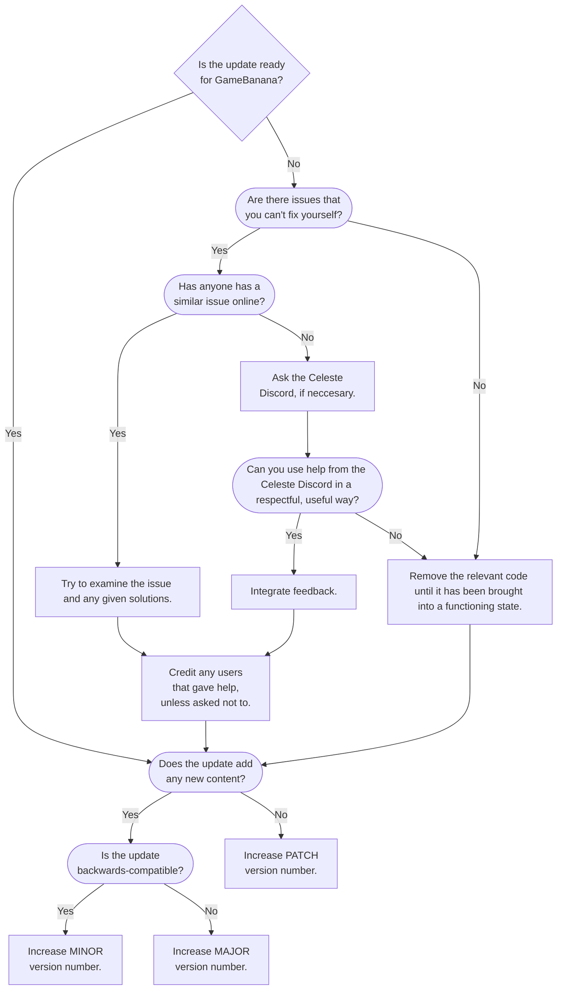

<!-- [GitHub](https://github.com/DatGuyAlex22/Follower-Addons-And-Such) -->
<!-- [GameBanana](https://gamebanana.com/mods/711016) -->

#

#
# Table of Contents
- [<u>Table of Contents</u>](#table-of-contents)
- [<u>Update Structure</u>](#update-structure)
- [<u>Update History</u>](#update-history)

# Update Structure

# Update History
| Version Number | Date Published | Relevance | Direct Download |
| :------------: | :------------: | :-------: | :-------------: |
| v1.0.0 | August 28th, 2026 | Release | [Download ZIP](https://gamebanana.com/dl/1800416) |
| v1.1.0 | August 29th, 2026 | Minor | [Download ZIP](https://gamebanana.com/dl/1801518) |
| v1.2.0 | September 2nd, 2026 | Minor | [Download ZIP](https://gamebanana.com/dl/1805577) |
| v1.2.1 | September 2nd, 2026 | Patch | [Download ZIP](https://gamebanana.com/dl/1805582) |
| v1.3.0 | September 3rd, 2026 | Minor | [Download ZIP](https://gamebanana.com/dl/1806415) |
| v1.3.1 | September 3rd, 2026 | Patch | YAML Error |
| v1.3.2 | September 5th, 2026 | Patch | [Download ZIP](https://gamebanana.com/dl/1808367) |
| v1.3.3 | September 6th, 2026 | Patch | [Download ZIP](https://gamebanana.com/dl/1809245) |
| v1.3.4 | September 9th, 2026 | Patch | [Download ZIP](https://gamebanana.com/dl/1812123) |
| v1.4.0 | September 14th, 2026 | Minor | [Download ZIP](https://gamebanana.com/dl/1817016) |
| v1.5.0 | September 18th, 2026 | Minor | [Download ZIP](https://gamebanana.com/dl/1820064) |
| v1.6.0 | October 2nd, 2026 | Minor | [Download ZIP](https://gamebanana.com/dl/1835188) |
| V1.7.0 | October 16th, 2026 | Minor | [Download ZIP](https://gamebanana.com/dl/1851464) |
| v1.7.1 | October 17th, 2026 | Patch | [Download ZIP](https://gamebanana.com/dl/1851904) |
| v1.7.2 | October 19th, 2026 | Patch | [Download ZIP](https://gamebanana.com/dl/1856315) |
| v1.8.0 | October 20th, 2026 | Minor | [Download ZIP](https://gamebanana.com/dl/1857521) |

#
### Version 1.1.0
    Removed the rogue Theo Crystal in the demo map.
    Added Trail Color Controllers (with a custom Loenn sprite by me!).
    Fixed some older dialog in the test map.
    Removed a Loenn plugin that created a non-existent entity.
### Version 1.2.0
    Added an option to make strawberries collect instantly.
    Added Player Temple Eyes that follow players instead of Theo Crystals.
    Added a default trail color for strawberry seeds.
    Added a description for some settings.
### Version 1.2.1
    Removed a setting under Experimental Options that was accidentally left in.
### Version 1.3.0
    Added a 'Stop Crystal Heart Collection' option to Experimental Options.
    Added a 'Settings Affect Golden Strawberries' option to Experimental Options.
    Added padding to some subheaders for a cleaner look.
### Version 1.3.1
    Removed the test map.
    Fixed an issue with the Stop Crystal Heart Collection option not saving.
    Fixed an issue where Strawberry Blockfield Triggers wouldn't work when Strawberry Collection Speed was set to 'Instant'.
### Version 1.3.2
    Fixed players and entities created by CelesteNet flashing rapidly between sizes.
    Fixed an issue where the Prevent Crystal Heart Collection option would not update it's value.
    Moved Prevent Crystal Heart Collection from Experimental Options to Cosmetic Options.
    Renamed Settings Affect Golden Strawberries to Leniency For Golden Strawberries and added a proper description.
### Version 1.3.3
    Fixed a typo where Debug Mode was incorrectly called 'Debug Move.
    Strawberries will now visually collect when collecting a level-ending Crystal Heart (currently does not support vanilla levels).
### Version 1.3.4
    Follower and Holdable scales can now be decimal values.
    Follower and Holdable scales can now only be between 0.0x-10.0x.
    Follower and Holdables will now scale up/down slightly smoother.
    Holdables will now scale down properly when not being held.
    Renamed 'resetdonotload' to 'wipedonotload' in the debug console.
    Wipedonotload now works as intended (instead of doing nothing at all).
    Follower Addons & Such will now be disabled in Mod Options by default to be more compatible with custom maps.
### Version 1.4.0
    Added an option to prevent strawberry seeds from popping away.
    Fixed an issue where entity sprites could get locked facing one direction when Follower Addons & Such was disabled.
    Reworked the Trail Color Controller to be easier to use for mappers.
### Version 1.5.0
    Reworked settings in the Mod Options menu (users may have to set their settings again).
    Removed some old dialog.
### Version 1.6.0
    Strawberries will now collect more consistently when set to collect instantly.
    Added an 'always scale' option to Follower Size / Holdable Size triggers.
    Added Entity Outliners for mappers.
    Added a setting to help reduce lag when carrying many followers at once.
### Version 1.7.0
    Added Disable Hair Gravity Triggers to match Mod Options.
    Added Crystal Heart Blockfield Triggers to match Mod Options.
    The 'Follower Lag Buffer' option can now be set to 0.
    Followers will now float to the player's respawn point when dying with 'Keep Strawberries After Death' enabled.
    Renamed the 'Place Large Entities Further Back' option to 'Place Resized Entities Further Back.'
### Version 1.7.1
    Added descriptions to some entries in the Mod Options menu.
### Version 1.7.2
    Entities following the player will not curve to the player's respawn point on death instead of moving in a straight line.
### Version 1.8.0
    Re-added the test map (players must edit .everestignore for it to load).
    Added Custom Register Area Complete Triggers.